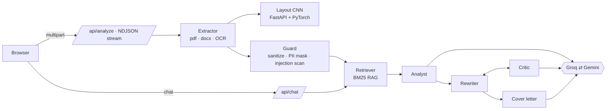

# Resume Reviewer Pro v2

Agentic AI resume analyzer — recruiter-grade ATS score, keyword gaps, a truthful 95%+ rewrite and a tailored cover letter, now with a multi-agent pipeline, RAG, a CNN layout check, a personal assistant chatbot, a security layer and Docker support. Built with **Next.js 14 + Groq + Gemini** (both free tier).

## What's new in v2

| Area | What you get |
|---|---|
| **Agentic AI** | 8 single-purpose agents with live progress: Extractor → Guard → Retriever → Layout CNN → Analyst → Rewriter ⇄ Critic → Cover letter → Interview prep |
| **Two LLMs** | Groq (Llama 3.3 70B) and Gemini; each agent has a preferred provider and falls back to the other on error / rate limit |
| **RAG** | Dependency-free BM25 retriever over a curated ATS/career knowledge base; feeds the agents and the chatbot, with sources shown |
| **CNN** | PyTorch CNN + FastAPI microservice that classifies the page layout (ATS-friendly / two-column / graphic-heavy) |
| **Assistant** | Floating chatbot that knows your latest scan (RAG-grounded, Groq → Gemini fallback) |
| **Security** | PII masking, prompt-injection scan, rate limits, upload validation, CSP & security headers, code-verified outputs |
| **Docker** | Multi-stage images (non-root), `docker compose up`, health checks |
| **Offline mode** | No keys? Rule-based scoring, keyword gaps and RAG chat still work |
| **UI** | Dark glass design, header/footer, hero, analyzer, features, pipeline, security & limits, stack, FAQ |

## Architecture



Deterministic code sits between the agents: keywords are re-checked against the resume text, model scores are blended with rule-based scores, the overall score is computed in code, and PII is restored locally only after the models have answered.

## Quick start (local)

```bash
npm install
cp .env.local.example .env.local      # paste your keys (optional)
npm run dev                           # http://localhost:3000
npm test                              # 16 tests: security, RAG, scoring, mocked live pipeline, API routes
```

Free keys (no credit card): **Groq** → <https://console.groq.com/keys> · **Gemini** → <https://aistudio.google.com/apikey>.
Set one or both. With neither, the app runs in offline mode.

### Optional: CNN layout service

```bash
cd cnn-service
python -m venv .venv && source .venv/bin/activate
pip install torch --index-url https://download.pytorch.org/whl/cpu
pip install -r requirements.txt
python train.py                       # ~1-2 min, writes model.pt
uvicorn app:app --port 8000
# then in .env.local:  CNN_SERVICE_URL=http://localhost:8000
```

## Docker

```bash
cp .env.local.example .env.local      # keys optional
docker compose up --build             # web → http://localhost:3000 (CNN is internal, trained at build)
```

## Deploy

**Vercel (web app, free):**
1. Push this folder to GitHub.
2. Vercel → *Add New Project* → import the repo (Next.js is auto-detected).
3. Environment Variables: `GROQ_API_KEY` and/or `GEMINI_API_KEY` (all environments).
4. Deploy. Without `CNN_SERVICE_URL` the layout check uses a text heuristic.

**Full stack (web + CNN):** run `docker compose up -d` on any VM (Oracle Always-Free, Hetzner, etc.), or deploy `cnn-service/` to Render/Fly/Railway and set `CNN_SERVICE_URL` on Vercel.

## GitHub Pages (static UI) + Vercel (backend)

GitHub Pages cannot run API routes, so the UI is published to Pages and the AI backend runs on Vercel.
The `Deploy to GitHub Pages` workflow builds a static export (`STATIC_EXPORT=1`), removes `app/api`, and bakes in the backend URL from the repository variable `API_BASE`.
On the Vercel side set `ALLOWED_ORIGINS=https://<user>.github.io` so the browser may call it.
Step-by-step (including phone/Termux commands): [`docs/TERMUX_GITHUB_PAGES.md`](docs/TERMUX_GITHUB_PAGES.md).

## Configuration

| Variable | Default | Purpose |
|---|---|---|
| `GROQ_API_KEY`, `GROQ_MODEL` | – / `llama-3.3-70b-versatile` | Groq provider |
| `GEMINI_API_KEY`, `GEMINI_MODEL` | – / `gemini-2.5-flash` | Gemini provider (`GOOGLE_API_KEY` from v1 also works) |
| `CNN_SERVICE_URL` | – | e.g. `http://localhost:8000` or `http://cnn:8000` |
| `MAX_FILE_MB` / `MAX_RESUME_CHARS` / `MAX_JD_CHARS` | 4 / 12000 / 6000 | Input limits (4 MB keeps uploads under Vercel's ~4.5 MB request cap) |
| `ALLOWED_ORIGINS` | – | Browser origins allowed to call the API (the Pages site) |
| `NEXT_PUBLIC_API_BASE` | – | Build-time backend URL for the static Pages build |
| `ANALYZE_LIMIT_PER_10MIN` / `CHAT_LIMIT_PER_10MIN` | 6 / 40 | Per-IP rate limits |

Model names are env-configurable because providers rename and retire models; change them if a default stops working.

## API

- `POST /api/analyze` — `multipart/form-data` with `file` *or* `resumeText`, optional `jd`, `tone`. Streams newline-delimited JSON: `{type:"agent",…}` events, then `{type:"result",data}` (or `{type:"error"}`).
- `POST /api/chat` — `{messages:[{role,content}], context?}` → `{reply, sources, provider}`.
- `GET /api/health` — configured providers (booleans only), mode, CNN status.

## Security & limitations

**Protections:** PII (email/phone) tokenised before any model call and restored only in your output; Aadhaar/PAN-like IDs removed; prompt-injection scan with documents wrapped as untrusted data; per-IP rate limits; size/type/magic-byte checks; capped text length and agent loops; keys server-side only and sent in headers; CSP, frame-deny, HSTS, `no-store` API responses; nothing is persisted.

**Limitations (please read):**
- The "estimated 95%+" is a model-assessed score, **not** a real ATS result.
- Free tiers rate-limit; heavy use needs paid keys. Groq's free TPM is small, so inputs are capped (tunable).
- The in-memory rate limiter is per server instance; use Redis/Upstash for strict global limits.
- The CNN is trained on **synthetic** page layouts as a demonstration (the task is easy; its validation accuracy says little about real resumes). Retrain on real labelled resumes for production.
- LLMs can make mistakes; review every rewritten line and replace `[add metric]` placeholders with real numbers.
- Scanned/image resumes depend on OCR quality (needs a Gemini key). English works best.

## Project structure

```
app/                     Next.js App Router (UI + API routes)
  api/analyze|chat|health
  components/            Header, Hero, Analyzer, Sections, Footer, ChatWidget, ScoreRing
lib/                     guard · llm · rag · kb · offline · agents · cnn
cnn-service/             dataset (synthetic) · model · train · FastAPI app · Dockerfile
tests/                   node:test suite
Dockerfile · docker-compose.yml · .github/workflows/ci.yml
```

## Author

**NIKHIL CHARY SRIRAMOJU** — [GitHub](https://github.com/Nikhil-creat) · [LinkedIn](https://in.linkedin.com/in/nikhil-chary-sriramoju-95041b38a) · [Instagram](https://www.instagram.com/nikhil__sriramoju)
